<p align="center"></p>

# Jcuki · waktu untuk bersama

Aplikasi penjadwalan untuk teman dengan shift kerja dan zona waktu berbeda. Tandai libur, isi jam bermain, lalu sepakati rencana. Komunikasi tetap lewat aplikasi pilihan kalian.

**Android 13+ · iPhone iOS 16.4+ · Bahasa Indonesia / English · Light / Dark / System**

**Develop by Terrence**

## Download

[Download disini memek](https://github.com/Adelberth-Von/App-Jcuki/releases/latest/download/JCuki-Android13-preview.apk)

[Tampilan dan kode sumber](https://github.com/Adelberth-Von/App-Jcuki) · [Release](https://github.com/Adelberth-Von/App-Jcuki/releases) · [Status build](https://github.com/Adelberth-Von/App-Jcuki/actions/workflows/mobile-build.yml)

APK tersedia melalui GitHub Release setelah workflow build dan publikasi berhasil. Link di atas langsung mengunduh file APK, tanpa ZIP atau membuka halaman Actions. Release diberi nama **Android preview**, memakai template debug signing key Expo untuk pengujian. APK menyertakan bundle JavaScript, sehingga tidak membutuhkan Metro/Expo Go. Untuk distribusi Play Store gunakan signing privat/EAS production. Jika belum ada release berhasil, lihat status build; jangan memasang APK lama dengan menganggapnya versi baru.

Untuk memasang: buka APK di Android 13 atau lebih baru, izinkan pemasangan dari sumber browser/file manager jika diminta OS, lalu buka Jcuki. iPhone memerlukan build terpisah melalui EAS dan Apple signing; APK tidak dapat dipasang di iPhone. Lihat [panduan build](docs/BUILD.md).

## Pembaruan 1.3.0

Server Supabase sudah dipasang dan menjadi koneksi bawaan. Mulai dari panggilan → buat/gabung grup → salin kode/link pada tab Grup. Tidak perlu mengisi URL server. [Panduan Supabase dan undangan](docs/SUPABASE.md).

Zona waktu mengikuti perangkat otomatis, tersedia tombol **Keluar demo**, tema navigator/latar native mengikuti Light/Dark, dan formatter kalender digunakan ulang untuk mengurangi pekerjaan saat menekan kontrol. Kelancaran serta kilatan layar masih perlu diverifikasi pada HP fisik; pengujian browser bukan pengganti pengukuran frame native.

## Apa yang diperbaiki

- **Identitas baru:** tiga teman mengelilingi jam, loading dengan gerak napas lembut dan transisi masuk. Tidak ada waktu tunggu buatan; animasi mengikuti Reduce Motion.
- **Kenalan dua langkah:** sambutan, panggilan, foto dari galeri, lalu buat/gabung lingkaran. Foto opsional; profil awal dapat disimpan sebelum menghubungkan backend. Mode contoh dapat dicoba langsung.
- **Desain hangat:** krem, hijau lumut, kontras yang nyaman, hierarki teks jelas, kartu lebih lega, tombol utama mudah dijangkau. Light, Dark, atau System dengan preview tampilan.
- **Kalender mingguan sebagai awal:** tampilan bulanan tetap tersedia. Satu editor untuk konfirmasi libur dan jam opsional, pilihan cepat Sore/Malam/Larut malam, lintas tengah malam, ringkasan durasi, dan beberapa rentang per hari.
- **Waktu tiap pengguna:** zona IANA otomatis dari OS. Jam sesi dikonversi ke zona pembaca; DST Berlin dan offset setengah jam ditangani. Tidak memakai GPS.
- **Kabar lingkaran:** ikon lonceng, riwayat aktivitas, status belum dibaca, filter jadwal/rencana, dan pagination. Push aktivitas untuk anggota lain disiapkan di backend dengan opt-out, antrean, retry dan receipt.
- **Pengingat:** mingguan sesuai hari/jam roster serta rencana yang diterima; suara original Jcuki Chime empat nada. Izin OS hanya diminta sesudah tindakan pengguna.
- **Aksesibilitas:** target tekan minimum 48×48, label kontrol, fokus input, dukungan pembesaran teks, dan animasi yang mengikuti Reduce Motion.

Lihat [catatan keputusan UX](docs/UX-DESIGN.md). Tidak ada chat internal. Hari belum diisi berarti **belum dikonfirmasi**, bukan otomatis sibuk.

## Panduan pemakaian

1. Masukkan panggilan; pilih foto dari galeri jika ingin. Foto yang dipilih dipotong persegi dan dikompres; aplikasi tidak membaca seluruh galeri.
2. Pilih **Lanjut**. Untuk mencoba tanpa server pilih **Jelajahi contoh**; data contoh diberi label dan tidak terhubung ke teman nyata.
3. Server Supabase sudah menjadi bawaan APK 1.3.0. Untuk keluar dari contoh, tekan **Keluar demo**. Lihat [panduan server](docs/SUPABASE.md).
4. Buat grup, buka tab **Grup**, salin kode atau link undangan, lalu teman menempelkannya pada **Gabung grup** di perangkat mereka. Mendukung tiga pengguna atau lebih dan beberapa lingkaran.
5. Saat roster keluar, buka **Kalender**, pilih tanggal, lalu konfirmasi libur. Nyalakan **Isi jam bermain sekarang** jika jamnya diketahui, isi mulai/selesai, dan simpan sekali. Memilih tanggal saja tidak menyimpan apa pun.
6. Tambahkan rentang lain bila perlu. Menghapus jam tetap mempertahankan libur; membatalkan libur menghapus jam yang terkait. Rentang bentrok dan waktu invalid ditolak.
7. Buka **Agenda → Buat rencana**, pilih tanggal/jam, lalu teman menjawab Bisa/Mungkin/Tidak bisa. Detail rencana menampilkan jawaban anggota dan ekspor kalender ICS. Percakapan dapat diteruskan melalui aplikasi lain.
8. Di **Pengaturan**, pilih bahasa, tema, format jam dan zona waktu. Aktifkan pengingat mingguan pada hari/jam yang cocok. Nyalakan notifikasi aktivitas sesudah integrasi push dikonfigurasi.
9. Ketuk ikon lonceng untuk membaca kabar. Halaman agenda, kabar, grup, teman, dan libur memiliki pagination; **Muat lebih banyak** meminta halaman server berikutnya.

## Tampilan setiap layar

Screenshot berikut berasal dari layar React Native yang dirender di browser untuk pemeriksaan layout, memakai data contoh. Picker OS, suara, keyboard, widget, dan push background harus diuji di aplikasi native.

<p>
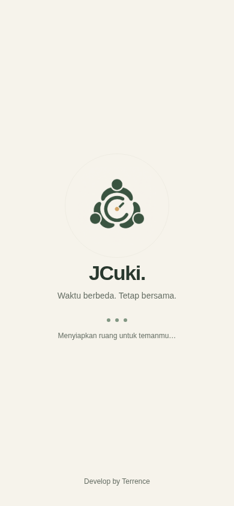
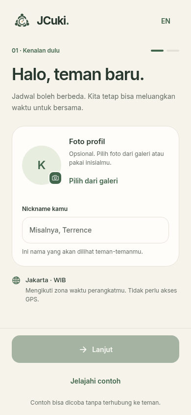
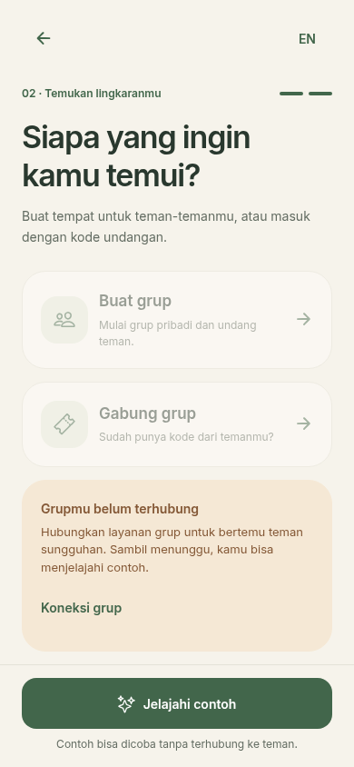
</p>
<p>

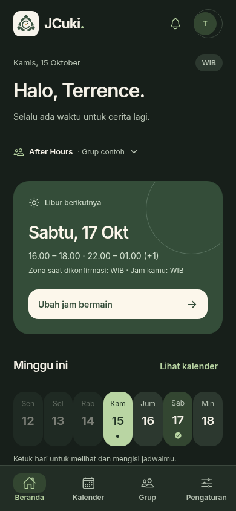
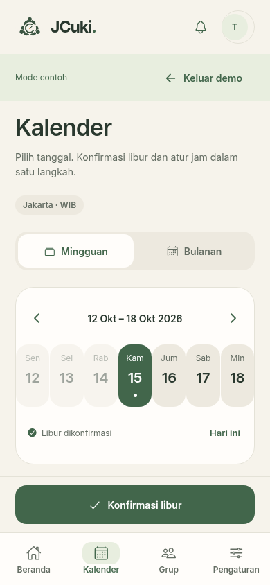
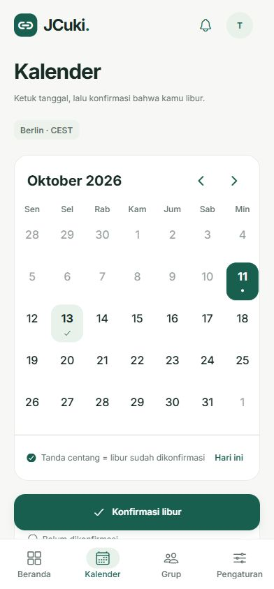
</p>
<p>
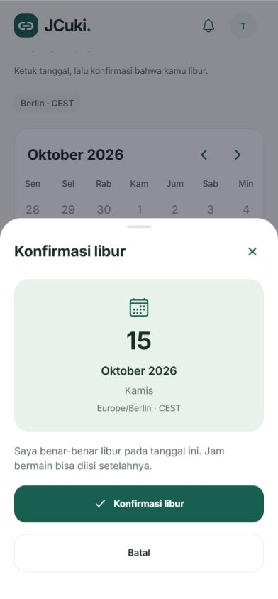
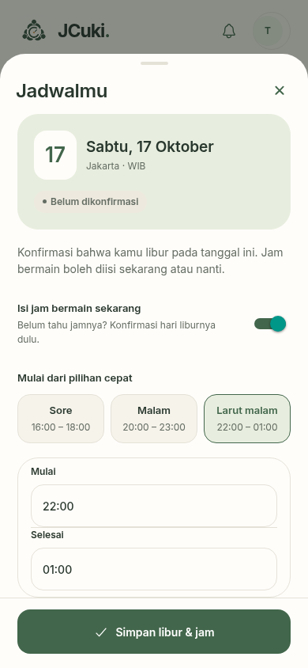
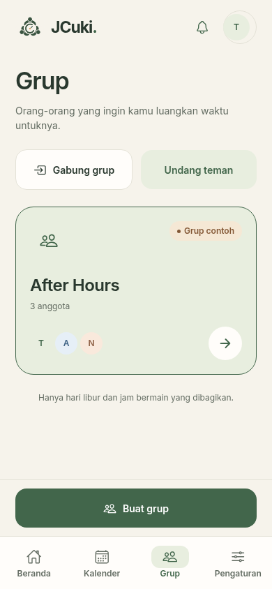
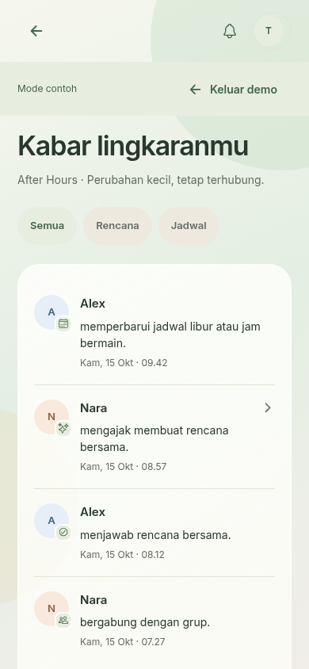
</p>
<p>
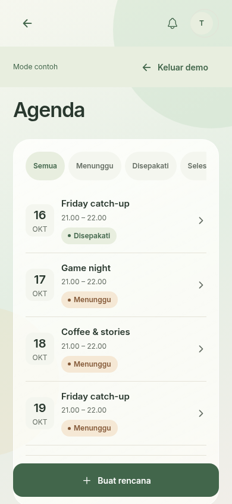
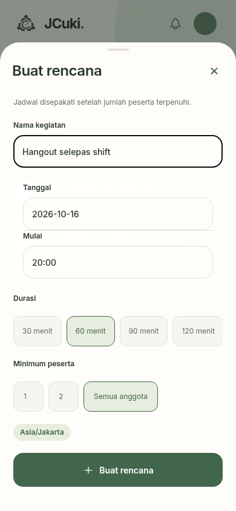
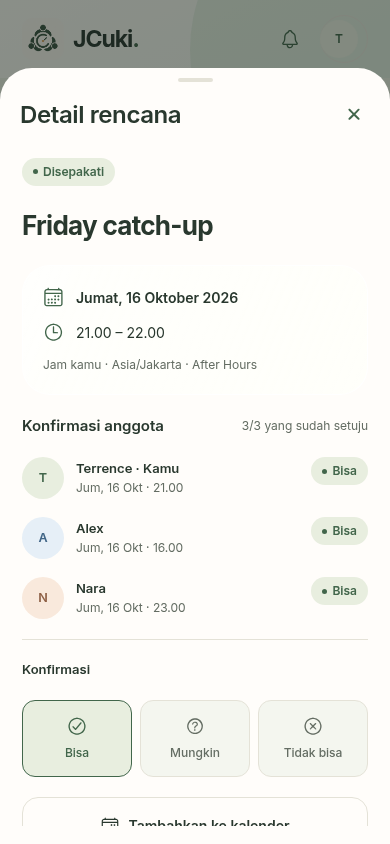
</p>
<p>
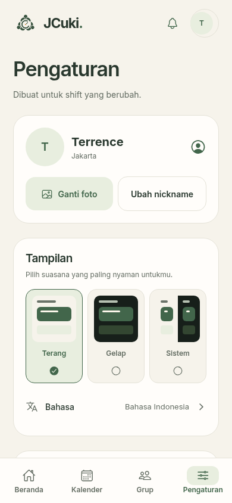
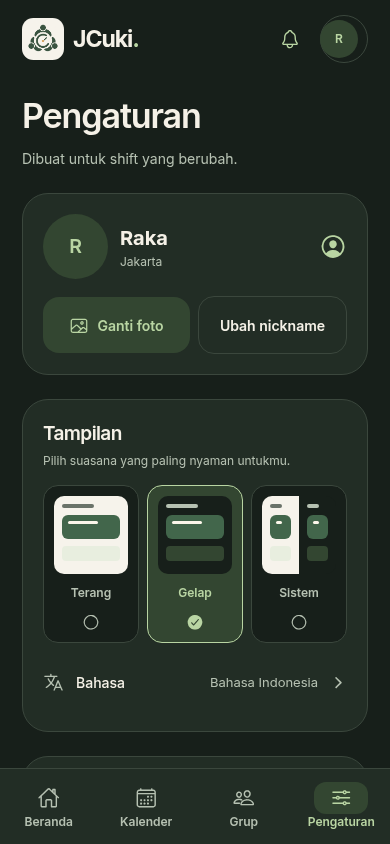

</p>

| Layar / dialog            | Preview                                                                                                                                                                                                                   |
| ------------------------- | ------------------------------------------------------------------------------------------------------------------------------------------------------------------------------------------------------------------------- |
| Undangan dari link | [Konfirmasi bergabung](docs/preview/join-invitation.png) |
| Loading                   | [Light](docs/preview/loading-light.png)                                                                                                                                                                                   |
| Sambutan, panggilan, foto | [Profil awal](docs/preview/welcome-light.png), [pilih lingkaran](docs/preview/welcome-circle.png), [ubah profil](docs/preview/profile-edit.png)                                                                           |
| Beranda                   | [Light](docs/preview/dashboard-light.png), [Dark](docs/preview/dashboard-dark.png), [English](docs/preview/dashboard-english.png), [320 px](docs/preview/dashboard-small.png), [430 px](docs/preview/dashboard-large.png) |
| Kalender                  | [Mingguan](docs/preview/calendar-week.png), [Bulanan](docs/preview/calendar.png), [320 px](docs/preview/calendar-small.png)                                                                                               |
| Editor jadwal             | [Konfirmasi libur](docs/preview/confirm-day.png), [Jam bermain](docs/preview/playing-hours.png)                                                                                                                           |
| Lingkaran                 | [Daftar grup](docs/preview/groups-light.png), [Buat](docs/preview/create-group.png), [Gabung](docs/preview/join-group.png), [Undangan](docs/preview/invite.png)                                                           |
| Agenda                    | [Daftar](docs/preview/agenda-light.png), [Buat rencana](docs/preview/create-plan.png), [Detail rencana](docs/preview/plan-detail.png)                                                                                     |
| Aktivitas                 | [Light](docs/preview/activity-light.png), [Dark](docs/preview/activity-dark.png), [English](docs/preview/activity-english.png)                                                                                            |
| Pengaturan                | [Light](docs/preview/settings-light.png), [Dark](docs/preview/settings-dark.png), [Notifikasi](docs/preview/settings-notifications.png)                                                                                   |

## Pagination: sudah ada

Daftar UI menampilkan **empat item per halaman** dengan Sebelumnya/Berikutnya dan nomor halaman; halaman dikoreksi setelah filter berubah. API menggunakan **cursor/keyset pagination** untuk grup, rencana mendatang/riwayat, dan aktivitas: default 20, batas 1–50, cursor terikat ke identitas/grup/view. Kalender memakai navigasi minggu/bulan. Pagination UI tidak menggantikan pemuatan server; tombol **Muat lebih banyak** melanjutkan cursor tanpa menduplikasi item. Tes mencakup pergantian halaman dan penolakan cursor lintas grup.

## Menjalankan dan menghubungkan teman

Gunakan Node.js 24+ dan npm:

```sh
npm ci
cp .env.example .env
npm run typecheck
npm run lint
npm test
npm start
```

`npm run web` untuk review layout. `npm run android` membutuhkan Android SDK; `npm run ios` membutuhkan macOS dan Xcode 26.4+. Widget, suara kustom, gallery OS, dan remote push membutuhkan native build; browser/Expo Go tidak membuktikan fitur tersebut.

Backend resmi memakai Supabase Edge Function + PostgreSQL dan sudah terpasang. Endpoint menjadi bawaan aplikasi. Backend memeriksa anggota grup, membatasi upload foto, dan menyimpan perubahan secara atomik. [Panduan Supabase](docs/SUPABASE.md). Cloudflare Worker + D1 tetap tersedia sebagai alternatif pengembangan.

Setiap instalasi memakai identitas perangkat privat. Belum ada login atau pemulihan akun lintas perangkat; menghapus data/reinstall dapat menghilangkan akses keanggotaan. Jangan menganggap nickname sebagai akun yang bisa dipulihkan.

## Notifikasi dan zona waktu

**Integrasi tersedia; kredensial proyek belum disertakan.** Ikuti [panduan Expo/EAS, Firebase/FCM v1 dan APNs](docs/NOTIFICATIONS.md) untuk push saat aplikasi tertutup. Status di Pengaturan membedakan izin, setup proyek, server belum aktif, siap, dan kesalahan. Aktivitas mencakup anggota baru, perubahan jadwal, rencana/jawaban/pembatalan dan profil. Pengirim dikecualikan; preferensi bahasa/suara penerima digunakan. Tanpa push siap, polling saat aplikasi terbuka merupakan fallback.

Pengingat mingguan merupakan jadwal lokal OS dan tetap terpisah dari push. Default belum aktif, Minggu 19.00; hari/jam dapat diubah. Zona otomatis mengikuti zona waktu OS dan diperbarui saat kembali aktif. Rencana lokal memakai data terakhir disinkronkan; buka aplikasi setelah perubahan teman untuk memperbarui pengingat. Sistem Focus/DND/izin OS dapat memengaruhi pengiriman dan suara.

[Dengarkan **Jcuki Chime**](assets/sounds/jcuki_chime.wav) · motif original C5–E5–G5–C6, 1,78 detik. Script pembuat: `node scripts/generate-notification-sound.mjs`.

Widget Android dan WidgetKit iOS menampilkan libur terdekat dan jam opsional; pengaturan widget membuka alur OS. Entry uninstall Android mengarah ke konfirmasi penghapusan sistem.

## Validasi

TypeScript, ESLint dan 45 tes Node memeriksa tiga identitas nyata pada backend SQLite, isolasi grup, foto, transaksi jadwal/aktivitas/antrean, pagination, zona waktu/DST, identitas perangkat, penyimpanan, terjemahan, serta properti WAV. Uji langsung pada Supabase memeriksa profil tiga zona, buat/gabung grup, penolakan anggota luar, jadwal, rencana, respons, foto, dan cursor aktivitas. Browser QA memeriksa kalender, lintas tengah malam, bentrok, pagination, persistensi, tema sistem, dan lebar 320/390/430 px. GitHub Actions memeriksa APK minSdk 33 dan signature sebelum publikasi. Status kompilasi terbaru dapat dilihat di link build; keberhasilan bundel bukan bukti QA perangkat.

Pengiriman push FCM/APNs, suara native, keyboard/gallery native, widget, TalkBack/VoiceOver dan performa perangkat tetap memerlukan uji Android/iPhone setelah konfigurasi. [Checklist perangkat dan build](docs/BUILD.md) · [Uji notifikasi tiga perangkat](docs/NOTIFICATIONS.md).

## English quick start

Jcuki helps a private circle share days off and optional playing hours across time zones. Download the Android 13+ preview above, enter a nickname/photo, and create or join a circle using the same deployed backend. Tap a calendar date, explicitly confirm your day off, optionally enter hours, then make a plan and collect friends' responses. Choose English and Light/Dark/System in Settings. Sample mode runs locally and does not connect real friends. Background activity push needs the project credentials described in [the notification guide](docs/NOTIFICATIONS.md); iPhone distribution requires Apple signing.

### Tampilan pembaruan 1.3.0

| Keluar demo | Undangan grup | Zona otomatis dan dark mode |
| --- | --- | --- |
| 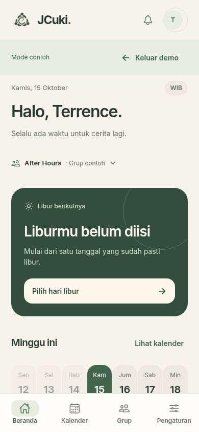 | 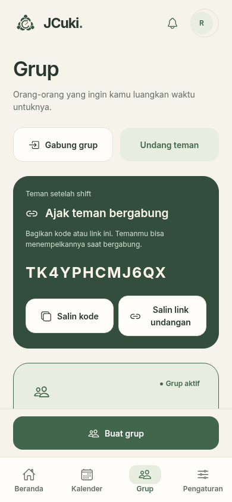 | 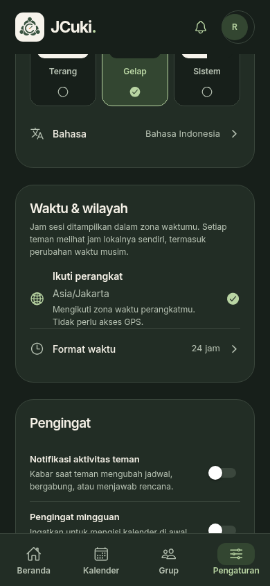 |

Screenshot adalah render aplikasi melalui React Native Web; tampilan dialog OS dapat berbeda pada Android/iPhone.
